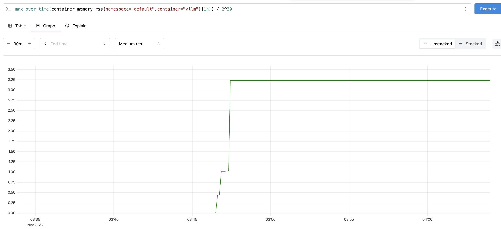
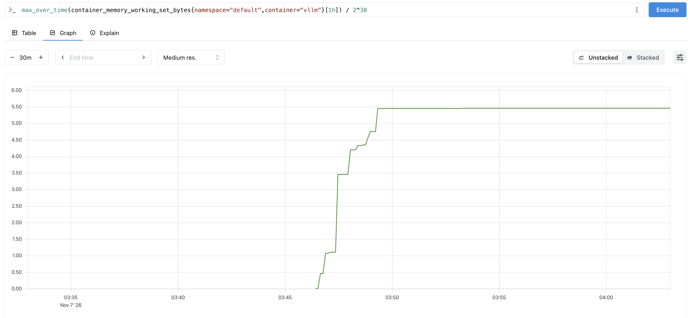
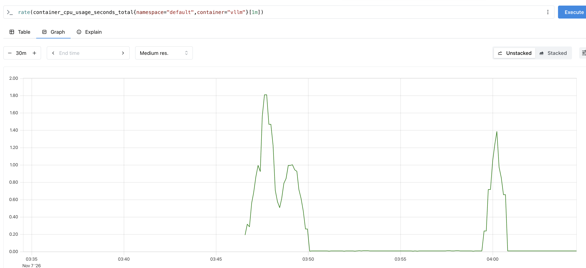

# Chapter 6: Autoscaling

Chapter 5's GPU node existed from `eksctl create` to `eksctl delete`, busy or not. This chapter makes the cluster add a GPU node when a pod needs one, remove it when nothing runs on it, and start vLLM from zero when a request arrives.

**You will have:** an EKS cluster with no GPU node until a pod asks for one, Prometheus storing vLLM's metrics and the container's memory and CPU, and an endpoint that scales to zero replicas and zero GPU nodes when idle and back up on the first request.

**You will measure:** seconds from a pending pod to a GPU node (41 s on the reference run), the memory and CPU vLLM actually uses against what it requests, seconds from the last request to the end of GPU billing (392 s), the first request after idle against the next one (324 s vs 0.31 s), seconds from a load spike to a second replica serving (7 min), the requests within the latency target before and after (24 to 51 of 64, then 64 of 64), and whether a replica removed mid-request finishes its requests (9 of 9).

## Files

| File                                             | What it is                                                                                    |
| ------------------------------------------------ | --------------------------------------------------------------------------------------------- |
| `eks-cluster.yaml`                               | The cluster: two small nodes for the controllers, no GPU node group, Karpenter's IAM wired in |
| `karpenter/gpu-nodepool.yaml`                    | How Karpenter launches GPU nodes: which machine, image, subnets and disk, and how many        |
| `manifests/vllm.yaml`                            | Chapter 5's Deployment and Service with a toleration, a Service label and a named port        |
| `manifests/vllm-servicemonitor.yaml`             | Tells Prometheus to scrape vLLM's `/metrics`                                                  |
| `manifests/vllm-scale-to-zero.yaml`              | Routes requests through KEDA's interceptor and lets KEDA scale vLLM between 0 and 1           |
| `karpenter/gpu-nodepool-scale-out.yaml`          | The NodePool for sections 8–10: g5.xlarge or g5.2xlarge, up to two GPUs                       |
| `manifests/vllm-scale-out.yaml`                  | The Deployment with smaller requests and a hook that drains requests before it stops          |
| `manifests/vllm-autoscale.yaml`                  | Section 7's file with up to two replicas and a Prometheus trigger on vLLM's request count     |
| `images/`                                        | The section 6 graphs from the reference run                                                   |
| `../03-serving-with-vllm/benchmark.py`           | The concurrency benchmark                                                                     |
| `../04-deploying-on-the-cluster/startup_time.py` | Seconds from pod creation to Ready                                                            |

## Prerequisites

- Chapter 5 done, and its cluster deleted.
- `aws`, `eksctl`, `kubectl`, `helm` and `envsubst` (from `gettext`) installed, and the AWS CLI logged in.
- A G-instance vCPU quota of at least 8 in us-west-2 (chapter 5, section 4).
- The session costs about $1.50 if you tear down at the end.

In zsh, run `setopt interactive_comments` once, or leave out any `#` comments when you paste commands.

## 1. Karpenter's permissions

Chapter 5's GPU node belonged to a managed node group: an AWS Auto Scaling group that eksctl created and that you resized by hand. Karpenter replaces it. It runs in the cluster, watches for pods the scheduler cannot place, and calls EC2 directly to launch a machine that fits them.

It needs AWS permissions for that, and the nodes it launches need a role of their own. Karpenter publishes them as a CloudFormation template:

```
curl -fsSL https://raw.githubusercontent.com/aws/karpenter-provider-aws/v1.15.1/website/content/en/preview/getting-started/getting-started-with-karpenter/cloudformation.yaml -o /tmp/karpenter-cfn.yaml
aws cloudformation deploy --region us-west-2 --stack-name Karpenter-mininfra \
  --template-file /tmp/karpenter-cfn.yaml --capabilities CAPABILITY_NAMED_IAM \
  --parameter-overrides ClusterName=mininfra
```

About a minute. List what it made:

```
aws cloudformation list-stack-resources --region us-west-2 --stack-name Karpenter-mininfra \
  --query 'StackResourceSummaries[].[LogicalResourceId,PhysicalResourceId]' --output text
```

- `KarpenterNodeRole-mininfra`: the role every Karpenter node runs as.
- Six `KarpenterController...Policy-mininfra` policies: what the Karpenter pod may do in EC2, IAM, EKS and SQS.
- `KarpenterInterruptionQueue` and five rules: EC2 posts spot reclaims, maintenance and instance state changes to an SQS queue named `mininfra`, and Karpenter drains a node before AWS takes it.

Nothing here is billed.

## 2. Create the cluster

`eks-cluster.yaml`, the parts that differ from chapter 5:

```yaml
metadata:
  tags:
    karpenter.sh/discovery: mininfra

vpc:
  nat:
    gateway: Disable

iam:
  podIdentityAssociations:
    - namespace: kube-system
      serviceAccountName: karpenter
      permissionPolicyARNs:
        - arn:aws:iam::${AWS_ACCOUNT_ID}:policy/KarpenterControllerNodeLifecyclePolicy-mininfra
        # ...the other five

iamIdentityMappings:
  - arn: arn:aws:iam::${AWS_ACCOUNT_ID}:role/KarpenterNodeRole-mininfra
    username: system:node:{{EC2PrivateDNSName}}
    groups: [system:bootstrappers, system:nodes]

managedNodeGroups:
  - name: system
    instanceType: m5.large
    minSize: 2
    maxSize: 2
```

- `tags`: eksctl copies the tag onto the subnets it creates. Karpenter finds its subnets by this tag.
- `nat.gateway: Disable`: a NAT gateway bills by the hour and $0.045 per GB through it, and every new GPU node pulls about 17 GB of image and weights. Without one, the GPU nodes go in the public subnets.
- `podIdentityAssociations`: the Karpenter pod gets the six policies from section 1 through its service account.
- `iamIdentityMappings`: nodes running as `KarpenterNodeRole-mininfra` may join the cluster as nodes.
- `system`: two m5.large for Karpenter, Prometheus and KEDA. There is no GPU node group.

Billing starts here: $0.10/hour for the control plane and $0.096/hour per m5.large.

```
export AWS_ACCOUNT_ID=$(aws sts get-caller-identity --query Account --output text)
time (envsubst < chapters/06-autoscaling/eks-cluster.yaml | eksctl create cluster -f -)
```

`envsubst` fills in your account ID. The reference run took 18 min 30 s. Then:

```
kubectl get nodes -L node.kubernetes.io/instance-type
```

```
NAME                                          STATUS   ROLES    AGE     VERSION                INSTANCE-TYPE
ip-192-168-13-12.us-west-2.compute.internal   Ready    <none>   2m44s   v1.34.12-eks-6e7947a   m5.large
ip-192-168-69-63.us-west-2.compute.internal   Ready    <none>   2m46s   v1.34.12-eks-6e7947a   m5.large
```

Check the tag reached the public subnets, one per zone:

```
aws ec2 describe-subnets --region us-west-2 \
  --filters Name=tag:karpenter.sh/discovery,Values=mininfra Name=tag:kubernetes.io/role/elb,Values=1 \
  --query 'Subnets[].AvailabilityZone' --output text
```

```
us-west-2a      us-west-2b      us-west-2c
```

## 3. Install the controllers

Five Helm charts. Each adds new kinds of Kubernetes object, called custom resource definitions (CRDs), and a controller that acts on them.

```
kubectl get crd | wc -l

helm repo add nvdp https://nvidia.github.io/k8s-device-plugin
helm repo add kedacore https://kedacore.github.io/charts
helm repo add prometheus-community https://prometheus-community.github.io/helm-charts
helm repo update

helm upgrade --install karpenter oci://public.ecr.aws/karpenter/karpenter --version 1.15.1 \
  --namespace kube-system --set replicas=1 \
  --set settings.clusterName=mininfra --set settings.interruptionQueue=mininfra \
  --set controller.resources.requests.cpu=1 --set controller.resources.requests.memory=1Gi \
  --set controller.resources.limits.cpu=1 --set controller.resources.limits.memory=1Gi --wait

helm upgrade --install nvdp nvdp/nvidia-device-plugin --version 0.20.1 --namespace kube-system

helm upgrade --install kps prometheus-community/kube-prometheus-stack --version 92.21.1 \
  --namespace monitoring --create-namespace \
  --set prometheus.prometheusSpec.serviceMonitorSelectorNilUsesHelmValues=false --wait

helm upgrade --install keda kedacore/keda --version 2.21.0 --namespace keda --create-namespace --wait

helm upgrade --install http-add-on kedacore/keda-add-ons-http --version 0.16.0 --namespace keda \
  --set scaler.replicas=1 --set interceptor.replicas.min=1 --wait

kubectl get crd | wc -l
helm list -A
```

The CRD count goes from 9 lines to 31: 22 new kinds.

| Chart                 | Kinds added | The one this chapter uses                      |
| --------------------- | ----------- | ---------------------------------------------- |
| Karpenter             | 4           | `NodePool`, `EC2NodeClass`, `NodeClaim`        |
| NVIDIA device plugin  | 0           | (a DaemonSet that advertises `nvidia.com/gpu`) |
| kube-prometheus-stack | 10          | `ServiceMonitor`                               |
| KEDA                  | 6           | `ScaledObject`                                 |
| KEDA HTTP add-on      | 2           | `InterceptorRoute`                             |

The `replicas` settings run one copy of each controller. The charts default to two or three for high availability, and with those the HTTP add-on's install times out:

```
Error: resource Deployment/keda/keda-add-ons-http-interceptor not ready. status: InProgress, message: Available: 1/3
context deadline exceeded
```

Helm reports a timeout; the reason is in the pending pod's events, `0/2 nodes are available: 2 Insufficient cpu`. Two m5.large offer pods about 3.9 CPUs, and Karpenter alone requests 1 CPU per copy. The scheduler places pods by what they request, not what they use.

The device plugin creates no pods yet. It only runs on nodes labelled `nvidia.com/gpu.present=true`, and there are none.

## 4. A NodePool for GPUs

`karpenter/gpu-nodepool.yaml` holds two objects. The `EC2NodeClass` says how to build an AWS machine:

```yaml
spec:
  role: KarpenterNodeRole-mininfra
  amiSelectorTerms:
    - alias: al2023@v20261031
  subnetSelectorTerms:
    - tags:
        karpenter.sh/discovery: mininfra
        kubernetes.io/role/elb: "1"
  securityGroupSelectorTerms:
    - tags:
        aws:eks:cluster-name: mininfra
  blockDeviceMappings:
    - deviceName: /dev/xvda
      ebs: { volumeSize: 100Gi, volumeType: gp3, iops: 4000, throughput: 1000 }
```

- `alias: al2023@v20261031`: the EKS Amazon Linux 2023 images of that release. Karpenter picks the NVIDIA variant for a GPU instance, with the driver installed.
- `subnetSelectorTerms`: the tagged subnets that are also public (`kubernetes.io/role/elb`).
- `securityGroupSelectorTerms`: the security group EKS created for the cluster, which the system nodes also use.
- The disk is chapter 5's.

The `NodePool` says which machines Karpenter may launch, and when to remove them:

```yaml
spec:
  template:
    metadata:
      labels:
        nvidia.com/gpu.present: "true"
    spec:
      requirements:
        - key: node.kubernetes.io/instance-type
          operator: In
          values: ["g5.2xlarge"]
        - key: karpenter.sh/capacity-type
          operator: In
          values: ["on-demand"]
      taints:
        - key: nvidia.com/gpu
          effect: NoSchedule
  limits:
    nvidia.com/gpu: 1
  disruption:
    consolidationPolicy: WhenEmpty
    consolidateAfter: 1m
```

- `labels`: the label the device plugin waits for. Without it the GPU is never advertised and the pod never schedules.
- `requirements`: only g5.2xlarge, only on-demand.
- `taints`: only pods that tolerate `nvidia.com/gpu` land here, so a pending Prometheus pod cannot make Karpenter rent a GPU to hold it.
- `limits`: at most one GPU across all nodes in this pool. One g5.2xlarge is 8 vCPUs, the quota.
- `disruption`: remove a node one minute after its last pod leaves.

```
kubectl apply -f chapters/06-autoscaling/karpenter/gpu-nodepool.yaml
kubectl get nodepool
kubectl get ec2nodeclass gpu -o jsonpath='{range .status.amis[*]}{.name}{"\n"}{end}'
```

```
NAME   NODECLASS   NODES   READY   AGE
gpu    gpu         0       True    20s

amazon-eks-node-al2023-x86_64-neuron-1.34-v20261031
amazon-eks-node-al2023-arm64-standard-1.34-v20261031
amazon-eks-node-al2023-arm64-nvidia-1.34-v20261031
amazon-eks-node-al2023-x86_64-standard-1.34-v20261031
amazon-eks-node-al2023-x86_64-nvidia-1.34-v20261031
```

Zero nodes, nothing billed. The alias resolved to five images; a g5.2xlarge gets `x86_64-nvidia`.

## 5. A pod asks for a GPU

`manifests/vllm.yaml` is chapter 5's manifest with three additions:

```yaml
tolerations:
  - key: nvidia.com/gpu
    operator: Exists
    effect: NoSchedule
---
kind: Service
metadata:
  labels:
    app: vllm
spec:
  ports:
    - name: http
      port: 8000
```

The toleration lets the pod onto the tainted GPU node. The Service label and port name are for Prometheus in section 6.

Open four terminals. Watch the NodeClaims, Karpenter's record of each machine it launches:

```
kubectl get nodeclaims -w
```

The nodes:

```
kubectl get nodes -L node.kubernetes.io/instance-type -w
```

Karpenter's decisions:

```
kubectl logs -n kube-system -l app.kubernetes.io/name=karpenter -f | grep -E 'found provisionable|launched nodeclaim|registered nodeclaim|initialized nodeclaim'
```

And in the fourth, apply and watch the events:

```
kubectl apply -f chapters/06-autoscaling/manifests/vllm.yaml
kubectl get events --sort-by=.lastTimestamp -w
```

The pod is pending first:

```
Warning   FailedScheduling   pod/vllm-7f8b6f5545-fm586   0/3 nodes are available: 2 Insufficient cpu, 2 Insufficient memory, 3 Insufficient nvidia.com/gpu. ...
Normal    Nominated          pod/vllm-7f8b6f5545-fm586   Pod should schedule on: nodeclaim/gpu-6pf75
```

`FailedScheduling` is what Karpenter waits for. `Nominated` is Karpenter answering: a machine is on its way, and the pod will go there. The reference run, from the Karpenter log:

| Time (UTC) | Event                                                         | Elapsed |
| ---------- | ------------------------------------------------------------- | ------- |
| 03:43:45   | Pod created, pending                                          | 0 s     |
| 03:43:46   | Karpenter: found provisionable pod, computed a NodeClaim      | 1 s     |
| 03:43:48   | Launched g5.2xlarge, on-demand, us-west-2a                    | 3 s     |
| 03:44:07   | Registered: the kubelet joined the cluster                    | 22 s    |
| 03:44:26   | Initialized: the device plugin advertised `nvidia.com/gpu: 1` | 41 s    |

41 seconds from a pending pod to a GPU the scheduler can use. Chapter 5's managed node group took 2 min 10 s for the same step. Karpenter calls EC2 directly, with no Auto Scaling group or CloudFormation in between, and nothing on the node waits for a NAT.

The `initialized nodeclaim` log line includes what the node offers pods:

```
"allocatable":{"cpu":"7910m","memory":"31465412Ki","nvidia.com/gpu":"1","pods":"58", ...}
```

7.91 of the 8 vCPUs and 30 of the 32 GiB. The kubelet and the operating system keep the rest.

From here it is chapter 5's startup. When the pod is Ready:

```
uv run python chapters/04-deploying-on-the-cluster/startup_time.py
```

```
vllm-7f8b6f5545-fm586: created 03:43:45, ready 03:49:17, 332 s
```

| Phase                                        | Time  |
| -------------------------------------------- | ----- |
| Karpenter: pending pod to GPU node           | 41 s  |
| Pull the image, 8.7 GB                       | 116 s |
| vLLM: download, load, compile, graphs, probe | 174 s |
| Total                                        | 332 s |

The last two rows match chapter 5's to within two seconds. Karpenter made the node fast; the new node still starts with an empty disk.

The event stream ends in a row of `Startup probe failed ... connection refused`. Probe failures are events, a passing probe is not, so the stream stops when vLLM is up. The progress is in `kubectl logs -f deploy/vllm`.

## 6. Prometheus

Chapter 5 read vLLM's metrics with a `curl` loop. Prometheus scrapes them every few seconds and keeps the history. `manifests/vllm-servicemonitor.yaml`:

```yaml
kind: ServiceMonitor
spec:
  selector:
    matchLabels:
      app: vllm
  endpoints:
    - port: http
      path: /metrics
      interval: 5s
```

It selects the Service by the label from section 5 and scrapes its port named `http` every 5 s.

```
kubectl apply -f chapters/06-autoscaling/manifests/vllm-servicemonitor.yaml
kubectl port-forward -n monitoring svc/kps-kube-prometheus-stack-prometheus 9090:9090
```

Open `localhost:9090`, Status, Targets: `serviceMonitor/default/vllm/0` is UP within 30 s.

Put load on vLLM. `kubectl port-forward` holds its terminal, so run it in the background:

```
kubectl port-forward svc/vllm 8000:8000 > /tmp/pf-vllm.log 2>&1 &
uv run python chapters/03-serving-with-vllm/benchmark.py --model Qwen/Qwen3-8B-FP8 --program --max-tokens 1024 --runs 1 --concurrency 32 --price-per-hour 1.21
```

```
concurrency= 32 aggregate= 1326.0 tok/s goodput= 1326.0 tok/s (32/32 in SLO) wall=  24.7 s | ttft median=  491 p99=  640 ms | tpot median= 23.7 p99= 24.0 ms | total median=  24.7 s
  $1.21/h -> $0.253 per M tokens at aggregate, $0.253 at goodput
```

Chapter 5's N=32 row on a node Karpenter launched. In the Prometheus Graph tab, one query per box (Add query for more), range 15m:

```
sum(vllm:num_requests_running)
sum(vllm:num_requests_waiting)
vllm:kv_cache_usage_perc
```

Running reaches 32, waiting stays 0, the cache peaks at 23%.

**What vLLM uses on the host.** kube-prometheus-stack also scrapes every kubelet, which reports each container's memory and CPU. It has been doing so since section 3, so the history covers the whole startup:

```
container_memory_rss{namespace="default",container="vllm"} / 2^30
container_memory_working_set_bytes{namespace="default",container="vllm"} / 2^30
rate(container_cpu_usage_seconds_total{namespace="default",container="vllm"}[1m])
```

RSS is memory the kernel cannot take back. The working set adds recently used file pages. On the reference run, lined up with vLLM's log:

| What vLLM is doing                      | RSS     | Working set        | CPU, peak |
| --------------------------------------- | ------- | ------------------ | --------- |
| API server process starts               | 1.0 GiB | 1.1 GiB            |           |
| Engine process starts, CUDA initialised | 3.2 GiB | 3.5 GiB            |           |
| Download and load the weights           | 3.2 GiB | rising             | 1.8 cores |
| Compile, capture CUDA graphs            | 3.2 GiB | rising to 5.45 GiB | 1.0 core  |
| N=32 benchmark                          | 3.0 GiB | 5.45 GiB           | 1.4 cores |

The reference run, graphed as the running peak with `max_over_time(...[1h])` around each memory query:







RSS stops at 3.2 GiB and never moves again. The 8.9 GiB of weights pass through the page cache on their way to the GPU, and the KV cache lives on the GPU. The page cache reached 7.5 GiB, and the kernel drops it whenever something needs the memory.

The manifest requests 4 CPUs and 16 GiB. vLLM used at most 1.8 and 3.2. A `rate()` over one minute smooths short peaks and the kubelet is scraped every 30 s, so leave room: 3 CPUs and 8 GiB covers both with margin. That fits a g5.xlarge, the same A10G with 4 vCPUs and 16 GiB for $1.01/hour, and two of those fit in the same 8 vCPU quota as one g5.2xlarge.

Stop the vLLM port-forward before the next section:

```
kill %1
```

## 7. Scale to zero and back

The node now leaves when vLLM does. What remains is making vLLM leave when nobody uses it, and come back when someone does.

KEDA scales a Deployment on a metric, down to zero replicas. With zero replicas there is no pod to answer the request that should wake it, so the HTTP add-on puts a proxy, the interceptor, in front of the Service. It counts requests in flight, tells KEDA, and holds each request until a pod is ready.

`manifests/vllm-scale-to-zero.yaml`:

```yaml
kind: InterceptorRoute
spec:
  target:
    service: vllm
    port: 8000
  rules:
    - hosts: ["*"]
  scalingMetric:
    concurrency:
      targetValue: 32
---
kind: ScaledObject
spec:
  scaleTargetRef:
    name: vllm
  minReplicaCount: 0
  maxReplicaCount: 1
  cooldownPeriod: 300
  triggers:
    - type: external-push
      metadata:
        scalerAddress: keda-add-ons-http-external-scaler.keda:9090
        interceptorRoute: vllm
```

- `InterceptorRoute`: requests for any host go to the `vllm` Service, and the target is 32 in flight per replica, chapter 5's best in-SLO concurrency.
- `ScaledObject`: KEDA may run `vllm` between 0 and 1 replicas, scales to 0 after 300 s with no requests, and gets the request count from the add-on's scaler.

```
kubectl apply -f chapters/06-autoscaling/manifests/vllm-scale-to-zero.yaml
kubectl get interceptorroute,scaledobject vllm
kubectl get hpa
kubectl get deploy vllm
```

```
NAME                                 TARGETSERVICE   READY   AGE
interceptorroute.http.keda.sh/vllm   vllm            True    0s

NAME                        SCALETARGETKIND      SCALETARGETNAME   MIN   MAX   READY   ACTIVE    ...
scaledobject.keda.sh/vllm   apps/v1.Deployment   vllm              0     1     True    Unknown   ...

NAME            REFERENCE         TARGETS              MINPODS   MAXPODS   REPLICAS   AGE
keda-hpa-vllm   Deployment/vllm   <unknown>/32 (avg)   1         1         0          1s

NAME   READY   UP-TO-DATE   AVAILABLE   AGE
vllm   0/0     0            0           22m
```

KEDA created a HorizontalPodAutoscaler, `keda-hpa-vllm`, for the 1-and-up range, and handles 0 itself. The Deployment went to zero at once: the 300 s cooldown counts from the last request KEDA saw, and a new ScaledObject has seen none. `initialCooldownPeriod: 300` in the ScaledObject would hold it for 300 s.

**Down.** The GPU node is now empty. A minute later Karpenter removes it:

| Time (UTC) | Event                                                   | Elapsed |
| ---------- | ------------------------------------------------------- | ------- |
| 04:05:37   | KEDA: replicas 1 → 0                                    | 0 s     |
| 04:06:53   | Karpenter: node empty for a minute, tainted and drained | 76 s    |
| 04:06:59   | EC2 `TerminateInstances`                                | 82 s    |
| 04:12:25   | NodeClaim and Node deleted                              | 6 min   |

Billing stops when the instance starts shutting down, at 82 s. The NodeClaim stays listed for another five minutes while Karpenter waits for EC2 to report the instance fully terminated. To see the billing state:

```
aws ec2 describe-instances --region us-west-2 --filters Name=instance-type,Values=g5.2xlarge \
  --query 'Reservations[].Instances[].[InstanceId,State.Name,StateTransitionReason]' --output text
```

```
i-03c5cfbb655d1cb35	terminated	User initiated (2026-11-07 04:06:59 GMT)
```

**Up.** Requests now go to the interceptor. Watch the NodeClaims in one terminal, and in another:

```
kubectl port-forward -n keda svc/keda-add-ons-http-interceptor-proxy 8080:8080 > /tmp/pf-icp.log 2>&1 &
date -u; time curl -s localhost:8080/v1/chat/completions -H 'Content-Type: application/json' \
  -d '{"model":"Qwen/Qwen3-8B-FP8","messages":[{"role":"user","content":"Say hi"}],"max_tokens":16,"chat_template_kwargs":{"enable_thinking":false}}'
```

The curl hangs while the cluster builds everything from nothing, then answers:

```
Sat Nov  7 04:14:30 UTC 2026
{"id":"chatcmpl-90d6823c23c21058", ... "content":"Hello!How can I assist you today? 😊" ...}
curl ... 5:24.17 total
```

Run the same curl again right away:

```
curl ... 0.309 total
```

| Time (UTC) | Event                                            | Step  |
| ---------- | ------------------------------------------------ | ----- |
| 04:14:30   | curl sent, the interceptor holds it              |       |
| 04:14:31   | KEDA: replicas 0 → 1                             | 1 s   |
| 04:14:32   | Karpenter: found the pending pod                 | 1 s   |
| 04:14:34   | Launched g5.2xlarge, us-west-2a                  | 2 s   |
| 04:15:14   | Node initialized, GPU advertised                 | 40 s  |
| 04:17:08   | Image pulled                                     | 114 s |
| 04:19:54   | vLLM Ready, the interceptor forwards the request | 166 s |

The autoscalers took 44 of the 324 seconds. The other 280 are the image pull and vLLM's startup, the same as section 5.

**Down again.** With the warm curl at 04:19:58 as the last request:

| Time (UTC) | Event                                 | Elapsed |
| ---------- | ------------------------------------- | ------- |
| 04:19:58   | Last request                          | 0 s     |
| 04:25:08   | KEDA: replicas 1 → 0                  | 310 s   |
| 04:26:24   | Karpenter: node tainted               | 386 s   |
| 04:26:30   | Instance shutting down, billing stops | 392 s   |

The 310 s is the 300 s cooldown plus KEDA's polling interval. Every quiet spell bills 392 s of g5.2xlarge after its last request, about $0.13.

**What scale to zero costs.**

|                  | First request after idle | Every other request | Idle cost                |
| ---------------- | ------------------------ | ------------------- | ------------------------ |
| Scale to zero    | 324 s                    | 0.31 s              | $0.13 per quiet spell    |
| One warm replica | 0.31 s                   | 0.31 s              | $1.21 × 730 = $883/month |

A chat user will not wait five minutes for the first token; a nightly batch job will. `cooldownPeriod` and `consolidateAfter` move the line: shorter saves money and sends more users into a cold start.

## 8. Two replicas on smaller nodes

Section 6 says vLLM fits a g5.xlarge. Three files change for the rest of the chapter. `karpenter/gpu-nodepool-scale-out.yaml`:

```
diff chapters/06-autoscaling/karpenter/gpu-nodepool.yaml chapters/06-autoscaling/karpenter/gpu-nodepool-scale-out.yaml
```

```
<           values: ["g5.2xlarge"]
>           values: ["g5.xlarge", "g5.2xlarge"]
<     nvidia.com/gpu: 1
>     nvidia.com/gpu: 2
```

Either size, up to two GPUs. Two g5.xlarge are 8 vCPUs; the quota check in chapter 5, section 4 needs to print at least 8, or 16 if Karpenter may pick two g5.2xlarge.

`manifests/vllm-scale-out.yaml`:

```
<               cpu: "4"
<               memory: 16Gi
>               cpu: "3"
>               memory: 8Gi
<               memory: 24Gi
>               memory: 12Gi
>       terminationGracePeriodSeconds: 180
>           lifecycle:
>             preStop:
>               exec:
>                 command:
>                   - python3
>                   - -c
>                   - |
>                     import re, time, urllib.request
>                     busy = re.compile(r"^vllm:num_requests_(running|waiting)\{.*\} [1-9]", re.M)
>                     time.sleep(5)
>                     while busy.search(urllib.request.urlopen("http://localhost:8000/metrics").read().decode()):
>                         time.sleep(2)
```

The requests from section 6. The `preStop` hook is for section 10.

`manifests/vllm-autoscale.yaml` is section 7's file with:

```
<   maxReplicaCount: 1
>   maxReplicaCount: 2
>   pollingInterval: 10
>   initialCooldownPeriod: 300
>     - type: prometheus
>       metadata:
>         serverAddress: http://kps-kube-prometheus-stack-prometheus.monitoring:9090
>         query: sum(vllm:num_requests_running) + sum(vllm:num_requests_waiting)
>         threshold: "32"
```

- `maxReplicaCount: 2`: up to two replicas.
- `pollingInterval: 10`: KEDA checks its triggers every 10 s instead of 30.
- `initialCooldownPeriod: 300`: no scale to zero in the first 5 minutes, so the replica you just started stays.
- The `prometheus` trigger: vLLM's own count of requests it is working on, 32 per replica. That is chapter 5's best in-SLO concurrency, so N=32 keeps one replica and N=64 asks for two.

The queue alone, `num_requests_waiting`, would not work. In chapter 5 it stayed at 0 until the cache filled at N=128, long after the SLO broke at N=64.

Start from section 7's state, or rebuild sections 1 to 3. Then:

```
kubectl apply -f chapters/06-autoscaling/karpenter/gpu-nodepool-scale-out.yaml
kubectl apply -f chapters/06-autoscaling/manifests/vllm-scale-out.yaml -f chapters/06-autoscaling/manifests/vllm-servicemonitor.yaml
```

Karpenter's log:

```
launched nodeclaim ... "instance-type":"g5.xlarge","zone":"us-west-2a","capacity-type":"on-demand"
initialized nodeclaim ... "allocatable":{"cpu":"3920m","memory":"15148020Ki","nvidia.com/gpu":"1", ...}
```

Both sizes were allowed, and Karpenter launched the cheaper one the pod fits. The startup, against section 5's g5.2xlarge:

| Phase                    | g5.2xlarge       | g5.xlarge |
| ------------------------ | ---------------- | --------- |
| Pending pod to GPU node  | 41 s             | 43 s      |
| Pull the image           | 116 s            | 133 s     |
| Download the weights     | 20 s (chapter 5) | 63 s      |
| Load the weights         | 25 s             | 28 s      |
| Compile, profile, graphs | 67 s             | 72 s      |
| Total                    | 332 s            | 413 s     |

The smaller instance has less network and disk bandwidth, and the download and pull pay for it. Once started, it serves the same: the KV cache is 136,272 tokens again, and the N=32 benchmark through the interceptor matches section 6:

```
kubectl apply -f chapters/06-autoscaling/manifests/vllm-autoscale.yaml
kubectl port-forward -n keda svc/keda-add-ons-http-interceptor-proxy 8080:8080 > /tmp/pf-icp.log 2>&1 &
uv run python chapters/03-serving-with-vllm/benchmark.py --url http://localhost:8080 --model Qwen/Qwen3-8B-FP8 --program --max-tokens 1024 --runs 1 --concurrency 32 --price-per-hour 1.01
```

```
concurrency= 32 aggregate= 1327.9 tok/s goodput= 1327.9 tok/s (32/32 in SLO) wall=  24.7 s | ttft median=  505 p99=  663 ms | tpot median= 23.6 p99= 23.9 ms | total median=  24.7 s
  $1.01/h -> $0.211 per M tokens at aggregate, $0.211 at goodput
```

The same card for 20% less per hour: $0.211 per million tokens instead of $0.253.

## 9. Scale out on load

Watch the autoscaler, the NodeClaims and the pods, one terminal each:

```
kubectl get hpa keda-hpa-vllm -w
kubectl get nodeclaims -w
kubectl get pods -l app=vllm -w
```

Then hold N=64, one run after another, with the price of one and two g5.xlarge:

```
for i in $(seq 1 18); do
  date -u +%T
  uv run python chapters/03-serving-with-vllm/benchmark.py --url http://localhost:8080 --model Qwen/Qwen3-8B-FP8 --program --max-tokens 1024 --runs 1 --concurrency 64 --price-per-hour 1.01 --price-per-hour 2.01
done 2>&1 | tee scale-out.log
```

The reference run:

| Time (UTC) | Event                                       | Elapsed    |
| ---------- | ------------------------------------------- | ---------- |
| 06:56:02   | 64 requests arrive                          | 0 s        |
| 06:56:28   | HPA: 1 → 2 replicas, new pod pending        | 26 s       |
| 06:56:31   | Karpenter: launched g5.xlarge in us-west-2c | 29 s       |
| 06:57:10   | Node initialized                            | 68 s       |
| 06:59:17   | Image pulled                                | 3 min 15 s |
| 07:03:00   | Second replica Ready                        | 6 min 58 s |

The HPA event names the trigger that fired:

```
SuccessfulRescale   New size: 2; reason: external metric s0-http_vllm_concurrency(...) above target
```

`s0-http_vllm_concurrency` is the interceptor's count, not Prometheus's. The interceptor pushes its count to KEDA as requests arrive; the Prometheus trigger waits for a scrape and a poll. KEDA follows whichever trigger asks for more replicas, and here both ask for the same, so the faster one decides.

`scale-out.log`, one line per run:

| Runs                   | Replicas | In SLO         | Aggregate tok/s | p99 TTFT       | median TPOT     |
| ---------------------- | -------- | -------------- | --------------- | -------------- | --------------- |
| 06:56 to 07:02, 8 runs | 1        | 24 to 51 of 64 | about 2,015     | about 1,140 ms | 30.9 ms         |
| 07:03 onward           | 2        | 64 of 64       | about 2,600     | about 700 ms   | 23.6 to 24.6 ms |

For seven minutes a third of the requests miss the 1 s TTFT target. Then every request meets it. Graph the split in Prometheus:

```
sum by (pod) (vllm:num_requests_running)
```

32 and 34: the Service spreads the interceptor's connections about evenly.

Two replicas did not double the throughput, from 2,015 to 2,600 tok/s. They moved each card from N=64 back to N=32, the point where chapter 5 said every request meets the target. Per million tokens, one card at N=64 costs $0.14 for tokens that mostly miss the SLO; two cards cost $0.21 for tokens that all meet it.

**A warm node.** After a scale-in (section 10), Karpenter waits a minute before removing the empty node. A scale-out inside that minute lands on it. The reference run did that once:

```
Normal  Pulled  Container image "vllm/vllm-openai:v0.29.0" already present on machine
```

Ready in 160 s instead of 413: no image pull, and the weights were already in the hostPath. What is left is loading the weights and compiling.

## 10. Scale in without dropping requests

A request to an LLM runs for tens of seconds. When the HPA removes a replica, Kubernetes takes the pod out of the Service, so no new requests reach it, and runs the `preStop` hook from section 8. The hook waits 5 s for requests already on their way, then polls the pod's own `/metrics` until nothing is running or waiting. Only then does vLLM get its stop signal. `terminationGracePeriodSeconds: 180` is the most Kubernetes waits for all of that.

Drop the load to N=16 with long requests, about 90 s each:

```
for i in $(seq 1 12); do
  date -u +%T
  uv run python chapters/03-serving-with-vllm/benchmark.py --url http://localhost:8080 --model Qwen/Qwen3-8B-FP8 --program --max-tokens 4096 --runs 1 --concurrency 16 --price-per-hour 2.01
done 2>&1 | tee scale-in.log
```

16 in flight is half of one replica's target. The HPA waits five minutes below target before it scales down, so nothing happens for 300 s. Then:

```
07:20:03  SuccessfulRescale   New size: 1; reason: All metrics below target
07:20:03  Killing             pod/vllm-fbbc876fc-drqmj   Stopping container vllm
```

The removed pod had 9 requests running. It took 50 s to go, until 07:20:53, and the run they belonged to finished normally:

```
concurrency= 16 aggregate=  705.1 tok/s goodput=  705.1 tok/s (16/16 in SLO) wall=  92.9 s | ttft median=  248 p99=  263 ms | tpot median= 22.6 p99= 22.7 ms | ...
```

16 of 16, and the same 92.9 s wall as the run before. Prometheus stopped seeing the pod 5 s after the scale-down: it scrapes through the Service, and the pod has left it. The hook reads the pod's metrics locally, so it still sees them.

Without the hook, vLLM gets the stop signal as soon as the pod leaves the Service, and requests still running can be cut off. A pod with nothing running is gone in about 10 s.

83 s after the pod went, Karpenter terminated its empty node, as in section 7.

## What to remember

- The autoscalers are fast and the model is slow. A cold start is mostly the image pull, the weight download and the compile, so image caching, streaming weights to the GPU and a compile cache are the levers. How long it takes decides between scale to zero, warm capacity and spot.
- Scale on what breaks the SLO first, not on the queue. vLLM queues only when the KV cache is full, long after latency has broken. Requests in flight catch compute running out; KV cache usage catches long contexts filling memory. Production usually uses both and scales on the first one breaching.
- A second replica at the same load buys latency, not throughput. Each card runs a smaller batch, so the price per token goes up. Throughput doubles only when the load does.
- Scale before the limit. A new replica takes minutes, so the threshold has to leave room for the load that arrives meanwhile. A sudden jump beats any threshold; only warm capacity covers it.
- LLM requests are long, so scale-in needs a drain. A `preStop` hook holds the pod until its requests finish, and the grace period must outlast the longest request.

## Delete everything

Karpenter's GPU nodes and the AWS objects it creates for them are in no eksctl stack. Remove them through Karpenter before the cluster goes:

```
pkill -f port-forward
kubectl delete -f chapters/06-autoscaling/manifests/ --ignore-not-found
kubectl delete -f chapters/06-autoscaling/karpenter/gpu-nodepool-scale-out.yaml
kubectl get nodeclaims,ec2nodeclass
```

The NodePool and the EC2NodeClass have the same names in both NodePool files, so either file deletes them. The command returns when Karpenter has terminated every GPU node, about five minutes. Deleting the `EC2NodeClass` makes Karpenter delete the instance profile and launch templates it created for it. Then:

```
helm uninstall karpenter -n kube-system
time eksctl delete cluster --region us-west-2 --name mininfra --wait
aws cloudformation delete-stack --region us-west-2 --stack-name Karpenter-mininfra
```

`--wait` keeps eksctl running until the network stack is gone, so a failure shows on screen. Then confirm nothing is left. Every command should print nothing:

```
aws eks list-clusters --region us-west-2 --output text
aws ec2 describe-instances --region us-west-2 --filters Name=instance-state-name,Values=pending,running,stopping,stopped \
  --query 'Reservations[].Instances[].InstanceId' --output text
aws ec2 describe-volumes --region us-west-2 --query 'Volumes[].VolumeId' --output text
aws ec2 describe-network-interfaces --region us-west-2 --filters Name=status,Values=available \
  --query 'NetworkInterfaces[].[NetworkInterfaceId,Description]' --output text
aws ec2 describe-launch-templates --region us-west-2 --filters Name=tag:eks:eks-cluster-name,Values=mininfra \
  --query 'LaunchTemplates[].LaunchTemplateName' --output text
aws cloudformation list-stacks --region us-west-2 --stack-status-filter CREATE_COMPLETE DELETE_FAILED DELETE_IN_PROGRESS \
  --query 'StackSummaries[].[StackName,StackStatus]' --output text
```

On both reference runs, every GPU node Karpenter had removed left one network interface behind, `available` with a description like `aws-K8S-i-...`. They hold the cluster's security group and a subnet, so `eksctl delete cluster --wait` sits at "waiting for CloudFormation stack" until they go. Run the network interface check in a second terminal while it waits, delete what it lists and then the security group, and CloudFormation finishes:

```
aws ec2 delete-network-interface --region us-west-2 --network-interface-id <eni-id>
aws ec2 delete-security-group --region us-west-2 --group-id <eks-cluster-sg-id>
```

The reference run used two sittings, each from `eksctl create` to `eksctl delete`:

| Item                           | Sections 1–7              | Sections 8–10            |
| ------------------------------ | ------------------------- | ------------------------ |
| Control plane, $0.10/hour      | $0.18                     | $0.13                    |
| 2 × m5.large, $0.096/hour each | $0.34                     | $0.26                    |
| GPU                            | g5.2xlarge, 35 min, $0.71 | g5.xlarge, 67 min, $1.12 |
| Total                          | about $1.23               | about $1.51              |
